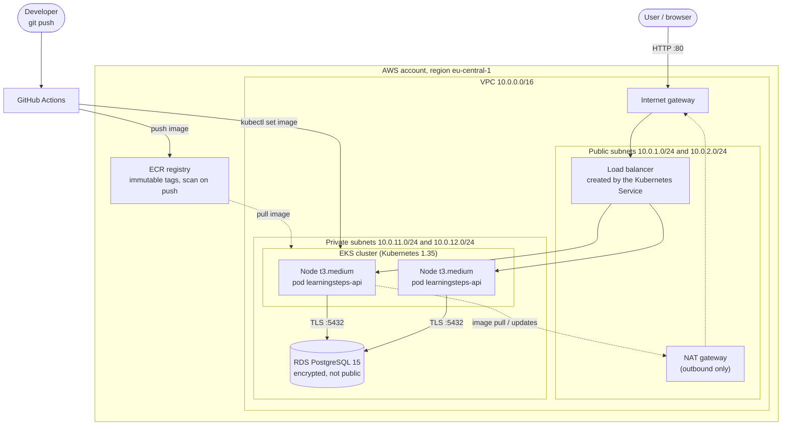
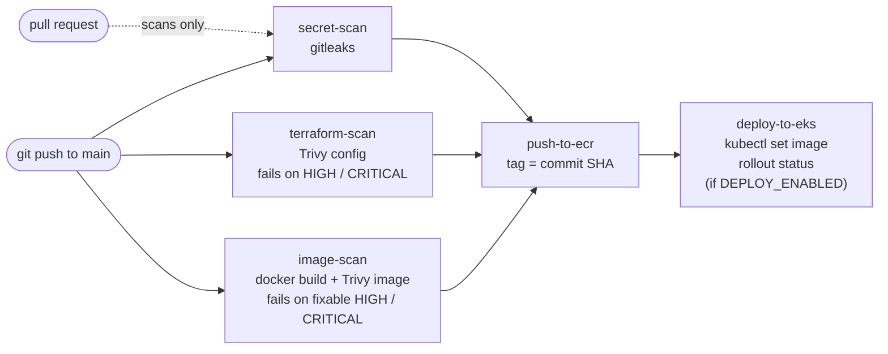
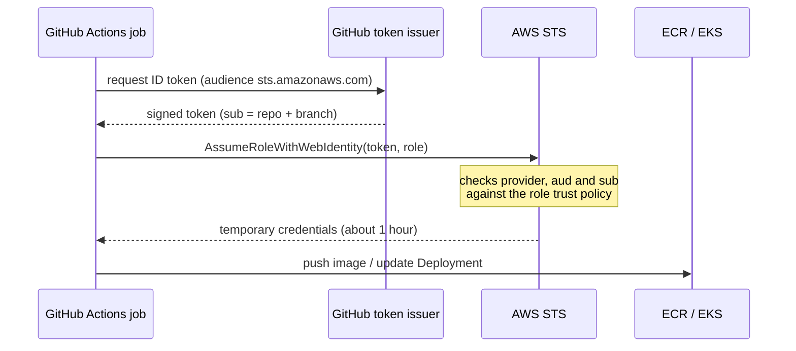

# LearningSteps on AWS: a DevSecOps pipeline from `git push` to a running Kubernetes app

[](https://github.com/nadeemkhan9876/amazon-forest/actions/workflows/ci.yml)

-FF9900?logo=amazonaws&logoColor=white)


A small FastAPI journal service, deployed on **Amazon EKS** with a private **RDS PostgreSQL** database. The whole environment is created from **Terraform**, and every push to `main` goes through a **security-gated GitHub Actions pipeline** that builds the image, pushes it to **ECR** and rolls it out to the cluster, **without any AWS access key stored in GitHub** (OIDC).

I built this as part of the Cybersteps Cybersecurity Analyst programme. It is the AWS rebuild of my earlier Azure project (AKS, ACR, Azure Database for PostgreSQL). I wrote the Terraform, the Kubernetes manifests and the pipeline myself, and documented every error I hit on the way.

> **What this repository demonstrates**
> - Infrastructure as code: network, database, registry, cluster and CI identity, rebuilt from scratch with `terraform apply` (33 resources) and removed with `terraform destroy`.
> - A pipeline that **fails on purpose**: insecure Terraform and a vulnerable Python package turn it red (evidence below).
> - Passwordless CI to AWS with OpenID Connect and a least-privilege role.
> - Network isolation that I can explain layer by layer (see [Security design](#security-design)).

---

## Contents

1. [Architecture](#architecture)
2. [CI/CD pipeline](#cicd-pipeline)
3. [Security design](#security-design)
4. [Tech stack](#tech-stack)
5. [Repository layout](#repository-layout)
6. [Run it yourself](#run-it-yourself)
7. [Evidence](#evidence)
8. [Design decisions and trade-offs](#design-decisions-and-trade-offs)
9. [Known limitations and roadmap](#known-limitations-and-roadmap)
10. [What went wrong and what I learned](#what-went-wrong-and-what-i-learned)

---

## Architecture

Region `eu-central-1` (Frankfurt). One VPC, two availability zones, public subnets for the load balancer and the NAT gateway, private subnets for everything that must not be reachable from the internet.



**Reading the picture**

| Part | What it is | Why it is built this way |
|---|---|---|
| Public subnets | Hold the load balancer and the NAT gateway. Their route table points to the internet gateway. | Only the load balancer has to be reachable from outside. |
| Private subnets | Hold the worker nodes and the database. Their route table points to the NAT gateway, **never** to the internet gateway. | Nothing in here can be reached from the internet. Outbound traffic (image pulls) works through NAT. |
| EKS cluster | Managed control plane, node group of 2 x `t3.medium`, metrics-server add-on. | Kubernetes keeps 2 pods running, replaces failed ones and rolls out updates without downtime. |
| RDS | PostgreSQL 15, `db.t3.micro`, 20 GB, `storage_encrypted = true`, `publicly_accessible = false`. | The database has no public address. |
| ECR | Private registry, **immutable tags**, scan on push, AES-256 at rest. | A tag can never be overwritten, so a tag always points to the same code. |

### Request flow

1. A user calls the load balancer on port 80.
2. The load balancer forwards to one of the application pods on the private nodes.
3. The pod reads its database address from a Kubernetes Secret and opens a TLS connection (`sslmode=require`) to RDS on port 5432.
4. The security group of RDS accepts port 5432 **only from the cluster's security group**.

---

## CI/CD pipeline

Defined in [`.github/workflows/ci.yml`](.github/workflows/ci.yml). Three scans run in parallel. Only if **all three are green** and the event is a push to `main`, the image is built and pushed. Deployment is a separate job behind an on/off switch.



| Job | What it checks or does | Fails when |
|---|---|---|
| `secret-scan` | gitleaks over the commits of the push or pull request | a key, password or token is found |
| `terraform-scan` | Trivy reads the `.tf` files like a blueprint | an insecure setting of severity HIGH or CRITICAL is not on the reviewed ignore list |
| `image-scan` | builds the Docker image, Trivy lists every package in it | a HIGH or CRITICAL vulnerability **with an available fix** exists |
| `push-to-ecr` | OIDC login, `docker build`, `docker push` with the commit ID as tag | any scan is red, or the event is not a push |
| `deploy-to-eks` | OIDC login, `aws eks update-kubeconfig`, `kubectl set image`, `kubectl rollout status` | the new pods do not become ready within 3 minutes |

### Passwordless login to AWS (OIDC)

No access key is stored in GitHub. Every run proves who it is with a short-lived signed token and receives temporary AWS credentials.



The role `amazon-new-github-actions-role` (see [`github-oidc.tf`](infra-terraform/github-oidc.tf)) trusts **only this repository on the branch `main`**. GitHub includes the numeric repository and owner IDs in the `sub` claim, so a deleted and re-created repository with the same name does not inherit the trust. Its permissions are limited to pushing to **one** ECR repository and describing **one** cluster. Inside Kubernetes the role has an EKS access entry with the AWS-managed `AmazonEKSEditPolicy`, limited to the `default` namespace ([`eks-access.tf`](infra-terraform/eks-access.tf)).

---

## Security design

The reviewer question for this kind of project is: *where does each isolation guarantee come from?* Here is the answer, layer by layer.

| Guarantee | Where it comes from |
|---|---|
| The database cannot be reached from the internet | Private subnets without a route to the internet gateway, **and** `publicly_accessible = false`, **and** a security group that accepts port 5432 only from the cluster's security group. Three independent controls. |
| Worker nodes are not directly reachable | They live in private subnets; the only inbound path is through the load balancer. |
| Outbound access is controlled | Private subnets reach the internet only through one NAT gateway (image pulls, updates). |
| Database traffic is encrypted in transit | `sslmode=require` in the connection string; a packet capture shows TLS, not SQL. |
| Data is encrypted at rest | RDS `storage_encrypted = true`, ECR AES-256. |
| No long-lived cloud credentials in CI | OIDC with a trust policy bound to repository, branch and numeric IDs. |
| Least privilege for the pipeline | ECR push to one repository, `eks:DescribeCluster` on one cluster, namespace-scoped Kubernetes edit rights. |
| Images are traceable and cannot be replaced | Immutable ECR tags; the tag is the Git commit ID. |
| Bad changes cannot reach the registry | `needs:` gates: three scans must pass before the build and push. |
| Secrets are not in Git | `.gitignore` for state, plans and credentials, gitleaks on every push, database password passed only through an environment variable (`TF_VAR_db_password`). |
| Containers run as non-root | Dedicated user in the Dockerfile; pinned dependency versions. |
| Accepted risks are documented | [`.trivyignore`](.trivyignore) lists every accepted Terraform finding with its reason; [`.gitleaks.toml`](.gitleaks.toml) holds one narrow exception (commit-ID image tags). |

---

## Tech stack

| Area | Tools |
|---|---|
| Cloud | AWS: VPC, EKS, RDS (PostgreSQL), ECR, IAM, IAM Identity Center (SSO) |
| Infrastructure as code | Terraform (AWS provider) |
| Containers | Docker, Python 3.12 slim image |
| Orchestration | Kubernetes: Deployment, Service (LoadBalancer), ConfigMap, Secret, HPA, metrics-server |
| CI/CD | GitHub Actions, OIDC federation |
| Security scanning | gitleaks (secrets), Trivy (Terraform and container image) |
| Application | FastAPI, asyncpg, PostgreSQL |
| Analysis | Wireshark (traffic captures), kubectl, AWS CLI |

---

## Repository layout

```text
.
├── .github/workflows/ci.yml     # pipeline: 3 scans, push to ECR, deploy to EKS
├── .gitleaks.toml               # gitleaks config (default rules + one narrow allowlist)
├── .trivyignore                 # accepted Terraform findings, each with a reason
├── app/
│   ├── Dockerfile               # slim base, non-root user, pinned requirements
│   ├── api/                     # FastAPI application
│   └── database_setup.sql       # table and indexes
├── infra-terraform/
│   ├── versions.tf              # provider and Terraform versions
│   ├── variable.tf              # inputs (the database password has no default)
│   ├── networking.tf            # VPC, subnets, IGW, NAT, route tables, security groups
│   ├── rds.tf                   # private PostgreSQL
│   ├── ecr.tf                   # registry (immutable tags, scan on push)
│   ├── eks.tf                   # cluster, node group, metrics-server add-on
│   ├── github-oidc.tf           # OIDC provider, role and policy for the pipeline
│   └── eks-access.tf            # lets the pipeline role change the Deployment
├── k8s-manifests/               # Deployment, Service, ConfigMap, HPA
└── docs/images/                 # screenshots used in this README
```

---

## Run it yourself

> **Cost warning:** while the full stack runs it costs about **$0.30 per hour** (EKS control plane, two nodes, NAT gateway, RDS) plus the load balancer. Destroy it when you are done.

**Prerequisites:** an AWS account, AWS CLI v2 with a configured SSO profile, Terraform, kubectl, Docker, and a fork of this repository (the OIDC trust in `github-oidc.tf` is bound to **my** repository and must be changed to yours).

```powershell
# 1. Sign in and choose a database password (letters and digits only; never commit it)
aws sso login --profile <your-profile>
$env:AWS_PROFILE = "<your-profile>"
cd infra-terraform
$env:TF_VAR_db_password = '<new password>'

# 2. Build the infrastructure (about 20 minutes)
terraform init
terraform plan -out=tfplan
terraform apply "tfplan"

# 3. Connect kubectl and prepare the database (it is private, so use a pod inside the cluster)
cd ..
aws eks update-kubeconfig --region eu-central-1 --name amazon-new-cluster --profile <your-profile>
kubectl get nodes
$DBPASS = "<same password>"
$RDS = "<rds endpoint without port>"
Get-Content app\database_setup.sql | kubectl run psql-setup --rm -i --restart=Never --image=postgres:15 --env="PGPASSWORD=$DBPASS" -- psql -h $RDS -U learningadmin -d learningsteps
kubectl create secret generic db-secret --from-literal=DATABASE_URL="postgresql://learningadmin:$DBPASS@$($RDS):5432/learningsteps?sslmode=require"

# 4. Let the pipeline build the first image (the registry is empty after a fresh apply)
git commit --allow-empty -m "Trigger pipeline: first image"
git push
#    then put the new commit ID as image tag into k8s-manifests/deployment.yaml and apply:
kubectl apply -f k8s-manifests/configmap.yaml -f k8s-manifests/deployment.yaml -f k8s-manifests/service.yaml -f k8s-manifests/hpa.yaml
kubectl get service learningsteps-api        # EXTERNAL-IP = load balancer address; open http://<address>/docs

# 5. Switch on automatic deployment:
#    GitHub > Settings > Secrets and variables > Actions > Variables > DEPLOY_ENABLED = true
#    From now on every push to main is deployed by the pipeline.

# 6. Shut everything down (order matters: the Service owns the load balancer)
kubectl delete -f k8s-manifests/service.yaml
kubectl delete -f k8s-manifests/hpa.yaml -f k8s-manifests/deployment.yaml -f k8s-manifests/configmap.yaml
kubectl delete secret db-secret
cd infra-terraform
terraform destroy
```

Set `DEPLOY_ENABLED` back to `false` before the destroy, otherwise the next push tries to deploy into a cluster that no longer exists.

---

## Evidence

### Pipeline end to end: all five jobs green

A one-line change was pushed; the scans passed, the image was built and pushed, and the Deployment was updated.


### The pipeline fails on a vulnerable package

On a test branch I pinned an old `urllib3 1.25.8`. The image scan went red and the pull request was closed without merging.


Trivy names the package, the installed version and the fixed version of each finding (7 HIGH):


The pipeline also failed on insecure Terraform (7 findings on the first scan). I fixed two (immutable ECR tags, no automatic public IP on public subnets) and wrote the reasons for the four accepted ones into `.trivyignore`.

### The app, live through the load balancer


---

## Design decisions and trade-offs

| Decision | Reason | Trade-off |
|---|---|---|
| **EKS** instead of ECS | The course goal is Kubernetes, and the skills carry over to AKS and GKE. | Higher running cost (control plane) and more to learn than ECS. |
| **OIDC** instead of access keys in GitHub secrets | No long-lived credential that can leak. | More initial setup (provider, trust policy, access entry). |
| **Immutable ECR tags, tag = commit ID** | Every image is traceable to its code; a tag can never be silently replaced. | A rebuild of the same commit needs a new commit. |
| **One NAT gateway** | Saves about $32 per month. | A single point of failure; production uses one per zone. |
| **`ignore-unfixed` in the image scan** | The Debian base image has High findings with no fix yet; failing on them would block every build without anyone being able to act. | Unfixed findings stay invisible to the gate, so the base image must be rebuilt regularly. |
| **Narrow scanner exceptions with a written reason** | A scanner that is switched off protects nothing; a scanner that blocks harmless things gets ignored. | Every exception needs an owner and a review date in a real team. |
| **`DEPLOY_ENABLED` switch** | The cluster only exists while I work on it; a deploy job without a cluster would turn every run red. | One more setting to remember. |
| **Targeted apply (`-target`) for the pipeline pieces** | Lets me create the registry and the CI role without building the expensive cluster. | Only for special cases; normal changes use a full plan. |

---

## Known limitations and roadmap

This is a learning and portfolio project, not a production system. What I would change for production, and what is still open:

- **No HTTPS yet.** The load balancer speaks plain HTTP, and a packet capture shows requests in clear text. Production: a certificate on the load balancer and a redirect to HTTPS.
- **Kubernetes Secret instead of AWS Secrets Manager.** The database URL is stored as a Kubernetes Secret (base64, not encrypted by default). Planned: Secrets Manager with a pod IAM role, and a KMS key for Kubernetes secrets encryption (an accepted finding in `.trivyignore`).
- **No remote Terraform state.** State is local. Production: S3 backend with locking, modules and separate environments.
- **Single-AZ database and a single NAT gateway**, `skip_final_snapshot = true`. Production: Multi-AZ, backups, deletion protection.
- **Public EKS API endpoint.** Production: private endpoint and a runner inside the VPC.
- **Actions pinned to version tags**, not commit hashes. Production: full commit hashes (a moved tag is how the March 2026 Trivy action incident worked).
- **No monitoring stack yet.** Planned: Prometheus and Grafana (optional).
- **Planned analysis:** Wireshark capture of the load balancer traffic and of the database connection, and VPC Flow Logs as evidence for the isolation claims.

---

## What went wrong and what I learned

Short list of the failures that taught me the most (the full day-by-day report with every error is kept outside the repository):

| Symptom | Cause | Lesson |
|---|---|---|
| `Not authorized ... could not be validated` (OIDC) | The identity provider I relied on belonged to a teammate and had been deleted. | In a shared account, create your own resources; do not depend on someone else's. |
| `Not authorized to perform sts:AssumeRoleWithWebIdentity` | GitHub now writes numeric IDs into the `sub` claim, so my trust rule did not match. | Print the **non-secret claims** of the token and compare them character by character. Never print the token. |
| gitleaks `403 Resource not accessible by integration` | The default token cannot read pull requests. | Give a job exactly the `permissions:` it needs. |
| gitleaks flagged an image tag as a key | A 40-character commit ID looks like a random key. | Judge the finding, write the narrowest exception, keep all other rules on. |
| `ImagePullBackOff` with `not found` | The tag in `deployment.yaml` did not exist in the rebuilt registry. | The tag in the Deployment must exist in ECR; read `kubectl describe pod`. |
| Database timeouts after adding an add-on | A security-group rule defined both inline and as a separate resource overwrote itself on every apply. | One style per security group. |
| Almost pushed a saved `tfplan` | It contains the database password. | `.gitignore` before the first commit; read `git status` before every `git add`. |
| `terraform destroy` did nothing | Run in the wrong folder; the state is in `infra-terraform`. | Read the end of the prompt before every destructive command. |

---

## Author

**Nadeem Khan**, Cybersecurity Analyst trainee at Cybersteps (Cologne, Germany), moving from technical project management into cybersecurity and platform engineering.
GitHub: [@nadeemkhan9876](https://github.com/nadeemkhan9876)

*Built for learning. The AWS account ID and all secrets are kept out of this document; the stack is destroyed after every work session.*
